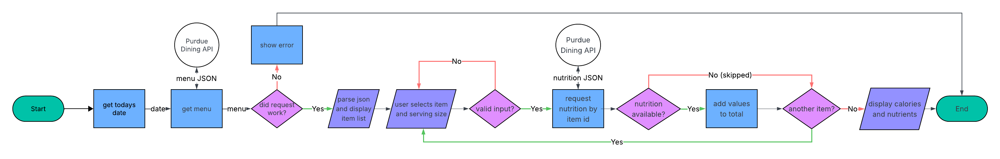

# Purdue Dining Nutrition Tracker

A tracker for total calories and macronutrients eaten in a dining hall. 

## The Problem

Most meals are eaten at the Purdue dining hall, and as someone who works out and wants to track my calorie intake and macronutrients, the dining hall is my biggest enemy. Even with the Purdue dining hall app showing the data, it's still difficult because there is no easy way to add it up and see the final total. So I want to be able to fix that problem.

## How It Works

- Call menu API and parse into JSON in java
- Get the nutrition API for an item 
- Show menu and let user select what they ate
- Add up the calories and nutrients
- Display the total calories and nutrients

## Tech Stack

- **Language:** Java
- **Libraries:** java.net.http.HttpClient, java.time, java.util.Scanner, Gson
- **External tools:** curl, Purdue Dining API

## Setup

1. Install Java
2. Clone Repo:
'''bash
   git clone https://github.com/ke1vn-s/cs193-final-proj
   cd cs193-final-proj
3. Download GSON '.jar' file and put in 'lib/' folder.

*coming back after code writeen*

## Usage

'''text
Dining Court: Wiley
1. Cheese Pizza
2. Lasagna
...
Select an item (0 to end): 1
Serving(s): 2
Select an item (0 to end): 0

Totals:
Calories: 300
Protein: 10g
Carbs: 3g
Fat: 15g
'''

## Roadmap

- [ ] Save each day into a log
- [ ] Choose any dining hall
- [ ] Handling items that don’t have nutrient info

## Author

Kevin Ho, (https://github.com/ke1vn-s)
